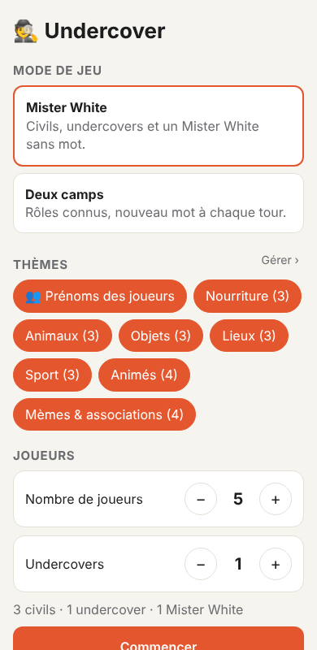

# 🕵️ Undercover

Version web du jeu de société Undercover, jouable sur un seul téléphone que l'on se passe de main en main.

## Principe

Chaque joueur reçoit un mot en secret. Les civils ont tous le même mot, les undercovers un mot proche, et le Mister White n'en a aucun. À chaque tour, chacun décrit son mot à l'oral, puis le groupe vote pour éliminer un joueur.

## Fonctionnalités

- Plusieurs modes de jeu, dont un mode avec **Mister White** (il peut tenter de deviner le mot des civils pour gagner)
- Distribution des mots en secret, joueur par joueur
- **Thèmes de mots personnalisables** : ajout et suppression de paires de mots
- Gestion des tours et des éliminations
- Sauvegarde des thèmes dans le navigateur

## Technologies

HTML, CSS et JavaScript pur (un seul fichier, aucune dépendance). Les thèmes sont conservés dans le navigateur (`localStorage`).

## Lancer le projet

Ouvrir `index.html` dans un navigateur. Aucune installation.
